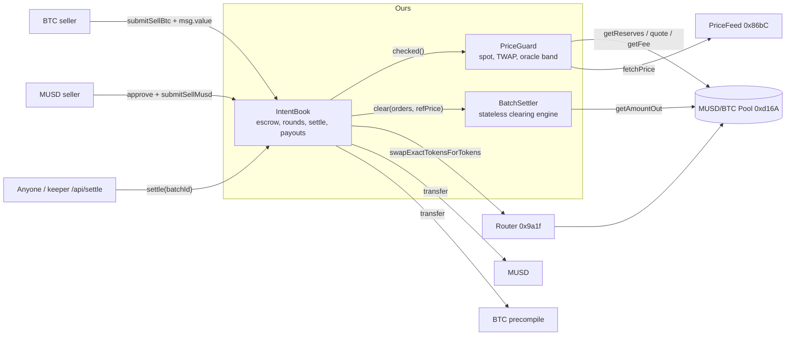

# Tandem

MUSD and BTC swaps on Mezo testnet, settled in 2-minute rounds.

Status: testnet only. Contracts are not deployed yet (see [Addresses](#addresses)).

## Problem

A swap on a constant-product pool moves the price against you. The bigger the swap, the worse the fill. Each swap also pays the pool fee, and separate swaps can be sandwiched by bots that see them in the mempool.

Two people who want opposite trades (one selling BTC for MUSD, one buying BTC with MUSD) both pay that cost, even though they could trade with each other.

## How it works

Swaps go into a 2-minute round. At the end of the round, swaps going opposite ways are matched with each other at the pool's mid price, with no pool fee and no price impact. Only the leftover goes through the Mezo Router, in one swap. Nobody gets less than the minimum they set.



- **Custody:** `IntentBook` holds every token and is the only contract that moves funds. `BatchSettler` and `PriceGuard` are view-only.
- **Guards:** the settle price must sit within 50 bps of the pool average price (TWAP), and the TWAP must sit inside an oracle band. If either check fails, settle reverts and the round waits or expires.
- **Refunds:** orders that would get less than their minimum are refunded. A round that cannot settle in time can be expired, and everyone is refunded.

### Prior art

- Batch auctions with one uniform clearing price come from **CoW Protocol** (coincidence of wants, then solvers route the rest).
- Frequent batch auctions as a defence against MEV come from **Budish, Cramton and Shim (2015)**.
- **Gnosis Protocol v1** ran on-chain batch auctions.

What is new here: it runs fully on-chain on Mezo with no off-chain solver. It has one pair, uses Mezo's own MUSD/BTC pool as both the price anchor and the fallback liquidity, and uses Mezo's PriceFeed as a sanity band. In our checks of Mezo's docs, deployed contracts and listed projects, we found no batch or matching swap product on Mezo. That means "not found in our checks", not "does not exist".

## Mezo contracts it calls

| Mezo contract | Function | Called from | Why |
|---|---|---|---|
| MUSD/BTC Pool `0xd16A5Df82120ED8D626a1a15232bFcE2366d6AA9` | `getReserves()` | `PriceGuard.read` | Spot mid = r0 · 1e18 / r1 |
| same | `quote(address,uint256,uint256)` | `PriceGuard.read` | TWAP: `quote(BTC, 1e16, 2)` × 100 |
| same | `getAmountOut(uint256,address)` | `BatchSettler.clear` | Exact output of the net Router leg |
| same | `token0()`, `token1()`, `stable()`, `metadata()` | `PriceGuard` constructor | Check token order, `stable == false`, decimals |
| same | `lastObservation()`, `observationLength()`, `observations(uint256)` | web app | Show TWAP age and window |
| same (optional) | `sync()` | keeper route only | Writes a TWAP observation when the pool is quiet |
| Router `0x9a1ff7FE3a0F69959A3fBa1F1e5ee18e1A9CD7E9` | `swapExactTokensForTokens(...)` | `IntentBook.settle` | The one net swap per round |
| same | `getAmountsOut(...)` | web app | "Swap alone now" quote |
| same | `poolFor(address,address,bool,address)` | `IntentBook` constructor | Check the pool address is the one we expect |
| PoolFactory `0x4947243CC818b627A5D06d14C4eCe7398A23Ce1A` | `getFee(address,bool)` | `PriceGuard.read` | Fee in bps, shown in the UI |
| same | `isPaused()` | `IntentBook.settle` | Revert early with `PoolPaused()` |
| PriceFeed `0x86bCF0841622a5dAC14A313a15f96A95421b9366` | `fetchPrice()` | `PriceGuard.read` (try/catch) | Oracle band. Reverts if the price is older than 60 s |
| MUSD `0x118917a40FAF1CD7a13dB0Ef56C86De7973Ac503` | `transferFrom`, `transfer`, `approve`, `balanceOf` | submit, payouts, Router leg | Escrow |
| BTC precompile `0x7b7C000000000000000000000000000000000000` | `transfer`, `approve`, `balanceOf` | submit (native value in), payouts, Router leg | Escrow |
| BorrowerOperations `0xCdF7…beE5` | `openTrove(uint256,address,address)` | `script/Demo.s.sol` only | MUSD for the demo wallets |

Signatures come from the verified Mezo contract ABIs. Mezo addresses are the testnet ones.

## Price decision

Which price clears the matched part? Example: spot is 0.40% above the TWAP (TWAP 78,224.80, spot 78,537.70).

| Option | BTC seller gets | MUSD seller pays | Problem |
|---|---|---|---|
| A. Match at TWAP | 78,224.80 | 78,224.80 | BTC sellers get 0.36% less than swapping alone. MUSD sellers can buy BTC in the round and sell it on the pool, with no risk. |
| B. Worst of both sides | 78,224.80 | 78,537.70 | 312.90 MUSD per matched BTC is left over and needs an owner, so it becomes a hidden fee. |
| **C. Spot at settle, with a TWAP guard (chosen)** | 78,537.70 | 78,537.70 | The matched side gets exactly the pool's mid price, and each side as a group does at least as well as one combined pool swap. 40 bps is under the 50 bps limit, so it settles. At +0.8% it reverts and waits or expires. |

Option C is what we use. The matched part always gets the price a zero-size swap would get at that moment. The TWAP still limits how far spot can move, and the oracle limits the TWAP.

This holds at settle time, not at the moment someone submits. Price can move between submit and settle. Each swap's minimum output limits that risk.

## Testnet caveats

- **Pool vs price feed gap.** On 2026-11-14 the pool TWAP was 1,714 bps (about 17%) above the Mezo PriceFeed. The testnet oracle band is set to `min(3000, gapBps + 400)`, which gave 2,114 bps. The band is re-measured at deploy time, and the deploy stops if the gap is above 2,600 bps. The band is wide on testnet, so the oracle check is weak here. On mainnet the plan is about 300 bps.
- **Quiet pool.** The TWAP uses the pool's last observations. On the testnet pool the last trade was about 6.8 hours old at the last check, so the TWAP window is hours old and can drift. The TWAP can be moved by holding a price over several observations, because testnet has no arbitrage to pull it back.
- **Wording.** This is a pool average price (TWAP). It is not a "1-hour average". The app shows the real window and its age.

## Security notes

- Owner powers: `setPaused(bool)` only. Pausing blocks new submits. It does not block cancel, settle, expire or claim.
- No owner function can move user funds. There is no sweep function.
- Settle is permissionless. Anyone can call it, and the price guards apply to every caller.
- No `receive()` or `fallback()` on `IntentBook`. Direct sends are not withdrawable.
- Payouts are pushed, and a failed push goes to a `claimable` balance that the user can withdraw.
- Known limits: up to 64 wei per token per round of rounding dust stays in the contract. There is no fee. One pair only.

The full list of trust assumptions, owner powers and threats is in [docs/SECURITY.md](docs/SECURITY.md).

## How to run locally

Requirements: Foundry, Node 22, pnpm 9.

```bash
# Clone with submodules (forge-std and OpenZeppelin)
git clone --recurse-submodules <REPO_URL>
cd mezo-batch-swap

# Contracts
cd contracts
forge build
forge test --no-match-path "test/fork/*"

# Web
cd ../web
pnpm install
pnpm build
pnpm test
```

Fork tests need an RPC and run against the Mezo testnet:

```bash
cd contracts
forge test --match-path "test/fork/*" --fork-url https://rpc.test.mezo.org
```

Keys are never stored in files. Pass them as an environment variable for one command only. See `.env.example` for the variable names.

## Addresses

Mezo testnet (chain 31611):

| Name | Address |
|---|---|
| MUSD/BTC Pool | `0xd16A5Df82120ED8D626a1a15232bFcE2366d6AA9` |
| Router | `0x9a1ff7FE3a0F69959A3fBa1F1e5ee18e1A9CD7E9` |
| PoolFactory | `0x4947243CC818b627A5D06d14C4eCe7398A23Ce1A` |
| PriceFeed | `0x86bCF0841622a5dAC14A313a15f96A95421b9366` |
| MUSD | `0x118917a40FAF1CD7a13dB0Ef56C86De7973Ac503` |
| BTC precompile | `0x7b7C000000000000000000000000000000000000` |
| BorrowerOperations | `0xCdF7028ceAB81fA0C6971208e83fa7872994beE5` |

Tandem (verified on the explorer, see [docs/DEPLOYMENT.md](docs/DEPLOYMENT.md)):

| Name | Address |
|---|---|
| IntentBook | `0x91713e27E072Bb058973e802807B66E4BD06ba80` |
| PriceGuard | `0x68B5007d9BbDCc01441047454a8A99a0F3e552b6` |
| BatchSettler | `0xACE4757a57Cf061A8B8eA09Bc8BEa34B6f284e5c` |
| Production web app | https://tandem-mezo.vercel.app |

## What "kept vs alone" does and does not promise

- The side with less volume is matched in full at the pool's mid price, so each of those swaps beats its own pool quote.
- The side with more volume shares one price. As a group it does at least as well as one combined pool swap of the same size.
- A small swap that shares the bigger side with a much larger swap can get a slightly worse rate than its own solo quote, because the price is shared. Your minimum still holds: if the round can't meet it, you are refunded in full. The app sets the default minimum 0.5% under the solo quote.
